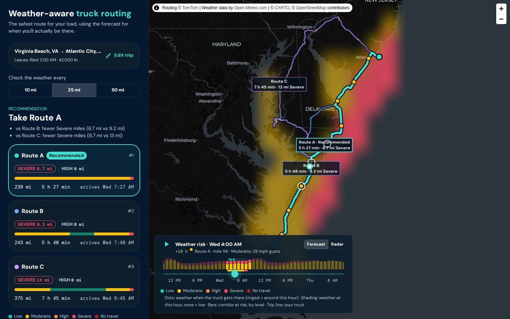

# Weather-Aware Truck Routing

Picks the safest truck route by checking the forecast **at each checkpoint for the moment the truck will actually be there**, applying the load-weight rules, and only then comparing travel time.

**Live app:** https://weather-truck-routing-1081490071089.us-central1.run.app
**Walkthrough (Loom):** _link coming_



## What it does

1. **Enter a trip:** origin and destination (autocomplete), a departure up to 48 h ahead, and the load weight.
2. **Get 3 truck routes.** Fewer only when the road network has no other route within twice the fastest time that isn't a near-copy. Each route is sampled every **10, 25 or 50 miles**. Switching the interval re-scores straight away, with no new routing call.
3. **Each checkpoint is checked against the forecast hour when the truck gets there**, scored with the brief's wind, rain and snow table plus the load rules.
4. **One route is recommended**, with a plain explanation of how it beat each alternative, e.g. *"vs Route B: fewer Severe miles (0 mi vs 31 mi)"*.
5. **The map** shows every route with a summary label (time and worst risk), the checkpoints coloured by risk, and tooltips with the cause ("38 mph gusts with a 42,000 lb load"), the ETA and the forecast hour used.
6. **A 0–48 h heatmap** along the trip corridor has a slider and a play button. Above the slider, a risk-over-time chart shows when bad weather peaks, with the trip window highlighted, so you don't have to scrub to find the storm. A truck marker and a status line follow the selected hour: *"Route A · mile 441 · Moderate: 0.30 in/hr rain"*, then *"arrived … · corridor forecast only"* once the trip is over. The checkpoints the truck passes around the selected hour get a ring, so you know which dots to compare with the shading.
7. **Live radar** (one switch away from the forecast): NOAA's current US radar, coloured by precipitation **type**: rain, cool rain, snow, storms, hail and tropical rain. It refreshes every 2 minutes. The forecast stays the planning layer; the radar shows what is falling right now.

## How the recommendation works


Routes are ranked **strictly in the brief's order**:

1. fewest **Severe** miles
2. fewest **High** miles
3. lowest **average risk** (mile-weighted, Low = 0 … No travel = 4)
4. shortest **travel time**

Values within a small tolerance count as ties, so rounding noise never decides a route. "No travel" isn't in the brief's list, so **any route with No-travel miles ranks below every route without them**. If every route has some, the app says there's no safe route at that departure.

### Rules the brief left open, and how we read them

| Question | Our rule |
|---|---|
| Shared boundaries (rain 0.25 is listed under both Moderate and High) | A boundary value belongs to the **higher** level. Rain/snow No travel is **strictly greater** than 1.00 / 3.0, as written. Every boundary has a unit test. |
| Sustained wind or gusts? | **Gusts**: high-profile trailers tip over on gusts, so this is the safer reading. It's one setting (`WIND_METRIC`), and sustained wind is shown too. |
| Overall level of a checkpoint | The **worst** of wind (after the load rules), rain and snow. |
| What counts as "Severe miles"? | Each checkpoint covers the road **halfway to its neighbours**, so a route's miles always add up to its length. |
| Rain rate | Open-Meteo `rain` **+ `showers`**. Showers are reported separately, and leaving them out would miss thunderstorm downpours. |
| Which forecast hour? | Departure + the routing API's travel time to that point, rounded to the **nearest hour**. |
| Dots and shading disagree? | They answer different questions. A dot is the forecast **when the truck reaches it**; the shading is the whole corridor **at the slider's hour**. Next to the truck marker (the ringed dots) they line up. The shading is also coarser (cells of 0.25–1°, smoothed) to fit 49 hours in one request. |
| Heatmap "0–48 h" | Hours from **now**, not from departure: it's a forecast for the corridor, and the hours after arrival still show whether leaving later would be safer. The trip window is highlighted and the status line says when the truck hasn't left yet or has already arrived. Low risk is left **unshaded**, so any tint means Moderate or worse. |
| Departure window | Now to now + 48 h, so every ETA stays inside a reliable forecast. |

## Architecture

```
frontend/  React 19 · Vite 8 · TypeScript · MUI 9 · MapLibre GL 6 + deck.gl 9 · TanStack Query
backend/   Django 6.1 · DRF · Python 3.13 (uv) · httpx
  routing/risk.py       pure classification rules             ← 42 boundary tests
  routing/sampling.py   checkpoints + ETA interpolation
  routing/recommend.py  route stats, ranking, "why"
  routing/heatmap.py    corridor grid → packed hourly risk
  routing/services.py   plan_trip(): the whole pipeline
  routing/providers/    tomtom.py · valhalla.py · open_meteo.py
```

**API** (same origin in production; Django serves the built frontend):

| Endpoint | Purpose |
|---|---|
| `POST /api/trips/` | `{origin, destination, depart_at, weight_lb, interval_mi}` → ranked routes, checkpoints, recommendation |
| `POST /api/heatmap/` | route paths + weight → all 49 hours of corridor risk in one ~14 KB payload |
| `GET /api/geocode/?q=` | place autocomplete (3+ characters, debounced, cached) |

Provider failures come back as stable codes (`no_route`, `rate_limited`, `weather_rate_limited`, …) that the UI turns into plain messages with a Retry button.

### Providers and resilience

| Need | Provider | Why |
|---|---|---|
| Truck routing | **TomTom** (`travelMode=truck`, `vehicleWeight`, live traffic) | Truck-aware, gives travel time along the route, free tier with no card |
| Routing fallback | **Valhalla** (OpenStreetMap, public server) | Used automatically if TomTom is down or rate-limited. The UI notes that live traffic isn't included. |
| Forecast | **Open-Meteo** hourly | No key, many points per request, mph and inches |
| Live radar | **NOAA MRMS** precipitation type (WMS) | Free, no key, CORS-enabled, a new US scan about every 2 min; loaded straight by the browser as map tiles |
| Basemap | CARTO Dark Matter | No key; matches the dark UI |

Speed and quota choices:
- TomTom's own `maxAlternatives` added ~5.5 s on long trips (measured 7.4 s vs 1.8 s). So the main route and two detours through offset waypoints are fetched **in parallel**, filtered for duplicates and for slow outliers. Only trips still short of 3 routes (short trips, where it's cheap) then ask TomTom for its alternatives, with looser limits: up to 2× the fastest and at least 10% different road.
- Open-Meteo counts every location as a call (10k/day, 600/min). Coordinates are snapped to a 0.1° grid and shared between routes. The heatmap only fetches a **corridor** of at most 300 cells.
- Everything is cached: routes for 10 min, forecasts for 30 min, searches for 1 day. Redis is used when `REDIS_URL` is set, in-process memory otherwise.

## Performance (measured on the hosted app)

| | Result |
|---|---|
| Plan a trip, fresh (Dallas → Denver, 3 routes) | **3.3 s** |
| Plan the same trip, cached | 0.39 s |
| Heatmap, all 49 hours | 1.5 s · 14 KB |
| Slider playback (Intel UHD 620, production build) | **60 fps**, slowest frame 16.8 ms |
| Initial JavaScript | 153 KB brotli; map code lazy-loaded |

The slider never touches the network. Each forecast hour is painted once into a cached GPU texture, and scrubbing only cross-fades between two of them.

## Run locally

Requirements: Node 24 (`nvm use`) and [uv](https://docs.astral.sh/uv/).

```bash
# API → http://localhost:8000
cd backend
cp .env.example .env        # add TOMTOM_API_KEY, or set DEMO_FIXTURES=1
uv sync
uv run python manage.py runserver

# UI → http://localhost:5173 (proxies /api to :8000)
cd frontend
npm install
npm run dev
```

**Demo mode** (`DEMO_FIXTURES=1`) replays a recorded real trip, so UI work costs no API quota.
`uv run python manage.py find_hazards` finds a real trip that crosses High or Severe weather in the next 48 h, which is handy for demos.

| Variable | Default | |
|---|---|---|
| `TOMTOM_API_KEY` | — | Truck routing and search |
| `DEMO_FIXTURES` | `0` | `1` = no provider calls |
| `WIND_METRIC` | `gust` | or `sustained` |
| `REDIS_URL` | — | shared cache; in-process cache if unset |
| `DJANGO_SECRET_KEY`, `DJANGO_DEBUG`, `DJANGO_ALLOWED_HOSTS` | dev values | production settings |

## Tests and quality

```bash
cd backend  && uv run pytest && uv run ruff check .     # 117 tests, providers mocked
cd frontend && npm run lint && npm run build             # oxlint + type check
```

- **What the tests cover:** every threshold boundary and load rule; the heatmap index always agreeing with the checkpoint level; checkpoint miles adding up; the ranking order with its tolerances; the provider fallback rules; and the API's request checks and error codes.
- **No real API calls in CI:** tests mock every provider and never depend on a developer's `.env`.

## Deploy

One Docker image: Vite build → Django + Gunicorn, with the frontend pre-compressed and served by WhiteNoise.

```bash
gcloud run deploy weather-truck-routing --source . --region us-central1 \
  --allow-unauthenticated --max-instances 2 --cpu-boost \
  --set-secrets TOMTOM_API_KEY=tomtom-api-key:latest,DJANGO_SECRET_KEY=django-secret-key:latest \
  --set-env-vars DJANGO_DEBUG=0,DJANGO_ALLOWED_HOSTS=.run.app
```

The same image runs on Railway or anywhere that sets `$PORT`.

## Trade-offs and next steps

- **Detour routes:** these sometimes look less natural than a router's own alternatives. They're filtered by overlap and time, and the routing response says which routes are detours.
- **Shorter trips:** a few (e.g. Corpus Christi → Brownsville) have only 2 truck routes within twice the fastest time. The UI says so rather than inventing a third.
- **Live radar coverage:** the NOAA mosaic covers the contiguous US only, like the rest of the app's routing.
- **Forecast-hour rounding:** checkpoints use the nearest forecast hour. Interpolating between hours would be a small refinement.
- **Next steps:**
  - a departure-time advisor ("leave at 14:00 → 0 Severe miles"), re-scoring the cached forecast for later departures;
  - shareable trip URLs;
  - a bottom-sheet layout on phones.
